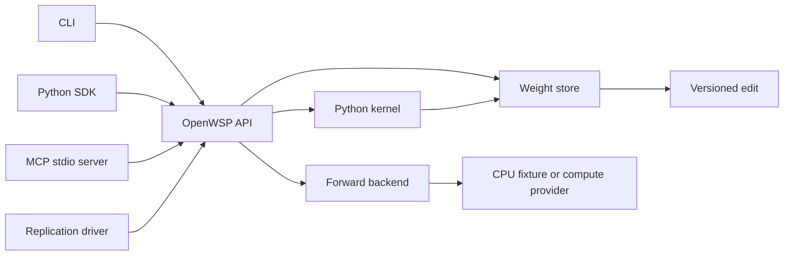

# Architecture

The CLI, Python SDK and MCP server call `OpenWSP`, one API over a weight store, a Python kernel and a forward backend. The core does not import Modal. A replication supplies the model, prompts, datasets, run policy and evaluation; it does not change the core to implement an experiment.



## Package boundaries

| Path | Responsibility |
| --- | --- |
| `src/openwsp/core.py` | Read original or edited tensors, enforce edit rules, import and export edits. |
| `src/openwsp/edits.py` | Versioned edit encoding, addresses and verification. |
| `src/openwsp/kernel.py` | Persistent Python namespace, execution limits and protocol refusals. |
| `src/openwsp/api.py` | Shared operations called by all interfaces. |
| `src/openwsp/cli.py`, `sdk.py`, `mcp_server.py` | Argument parsing or transport around the shared operations. |
| `src/openwsp/backends/` | Provider-specific forward execution. |
| `src/openwsp/backends/modal_api.py` | Built-in public Modal transport, durable local reservations, exact edit transfer and verified artifact downloads. |
| `src/openwsp/backends/public_forward.py` | Registered Qwen gateway: validates the pinned base and edits, dispatches bounded model workers and accounts for their aggregate cost. |
| `src/openwsp/editors/` | Editor API adapters and response state. |
| `src/openwsp/publishing.py` | Publish allowlisted result artifacts and regenerate only the README's marked tables. |
| `replications/` | Experiment configuration, source references and results. Experiments 1–7 are layout placeholders only. |
| `tests/` | CPU tests, including a real MCP client driving a tiny network. |

## Weights and edits

The store keeps the base immutable. `load_original(name)` returns a float32 copy of the base tensor; `load(name)` returns a float32 copy of the current submitted edit when one exists. `save_edit` validates a whole tensor before replacing its submitted value. For Experiment 8, frozen final norm, embedding and output tensors, whole-tensor rescaling, wrong shapes and non-finite values are refused. The scaling check uses `rtol=1e-5` and `atol=1e-7`; these are explicit OpenWSP choices because the authors did not publish their implementation.

Submitted edits retain float32 values while the evaluated checkpoint uses bfloat16. An exported edit records the evaluated values and verifies the base and edited tensor hashes. See the [edit contract](edit-format.md). A digest identifies content, not the quality or behavioral effect of a change.

## Kernel and execution

Kernel variables survive between code runs in the same SDK kernel or MCP server process. Separate CLI invocations reload saved edits, but do not retain Python variables. The namespace exposes `NAMES`, `load`, `load_original`, `save_edit`, `drop_edit`, `edited` and `tok`. The last expression is displayed. Gradients are disabled; the replication sets code-run, time and output limits.

The Python kernel's checks enforce the research protocol. They are not an operating-system security boundary. A local SDK or MCP kernel executes with the server process's access; the Experiment 8 driver uses a separate network-blocked Modal Sandbox without secrets, with only the intended model, practice and work paths available. Model inference belongs to the forward backend.

The original Experiment 8 harness was not published. OpenWSP reconstructs its public contract from the released task messages, request/result records and scripts. Any unresolved implementation detail must be recorded in `DECISIONS.md`, not presented as a recovered original behavior.

## Use another model

Create a store from a safetensors checkpoint and pass a backend with `forward(request, store) -> dict`. Tensor reads and versioned edits are independent of the model architecture. Generation templates, tensor restrictions, hooks and grading belong in the backend and replication configuration.

```python
from openwsp.sdk import OpenWSP
from my_backend import my_forward_backend

api = OpenWSP(
    "/absolute/path/model.safetensors",
    work_dir="/absolute/path/work",
    backend=my_forward_backend,
)
print(api.list_tensors())
print(api.read_tensor("layer.weight", offset=0, limit=16))
print(api.run_code("w = load('layer.weight'); w.shape"))
print(api.diff())
api.export_edit("/absolute/path/edit", base_model="owner/model", revision="pinned-revision")
```

Changing the target model does not make an Experiment 8 result comparable to the original. Use a separate replication configuration and report it as a separate run.

## Built-in Modal forward backend

The shipped factory `openwsp.backends.modal_api:from_env` works with the SDK, CLI and MCP server. It needs an existing deployment implementing the public envelope below; it never deploys an app or starts paid work on construction. The included `openwsp-exp8` deployment registers the `public_forward` function for `Qwen/Qwen3.5-0.8B` at revision `2fc06364715b967f1860aea9cf38778875588b17`. Prepare that deployment's pinned base before use. The public gateway does not run the editor or experiment evaluation protocol.

Install the provider extra with `uv sync --locked --extra modal`. Authenticate Modal using its normal credential configuration. In a proxied environment, retain the environment's proxy settings and `SSL_CERT_FILE` or `REQUESTS_CA_BUNDLE`; the adapter adds that CA bundle without disabling certificate verification. Credentials do not belong in requests, manifests or returned results.

Use a local checkpoint from the same immutable revision. For example, `huggingface_hub.snapshot_download(repo_id="Qwen/Qwen3.5-0.8B", revision="2fc06364715b967f1860aea9cf38778875588b17", local_dir="/absolute/path/qwen")` downloads the base for tensor reads. Then configure the existing deployment:

```sh
export OPENWSP_MODAL_APP=openwsp-exp8
export OPENWSP_MODAL_FUNCTION=public_forward
export OPENWSP_MODAL_BASE_MODEL=Qwen/Qwen3.5-0.8B
export OPENWSP_MODAL_BASE_REVISION=2fc06364715b967f1860aea9cf38778875588b17
export OPENWSP_MODAL_WORK_DIR=/absolute/path/work/modal
export OPENWSP_MODAL_BUDGET_USD=10
export OPENWSP_MODAL_ARTIFACT_VOLUMES='["openwsp-exp8-data"]'
export OPENWSP_MODAL_LIMITS='{"gpu":null,"cpu_cores":1,"memory_gib":4,"timeout_seconds":3600,"startup_seconds":120,"scaledown_seconds":5,"children":[{"gpu":"H100","cpu_cores":4,"memory_gib":16,"timeout_seconds":1800,"startup_seconds":600,"scaledown_seconds":120},{"gpu":"H100","cpu_cores":4,"memory_gib":16,"timeout_seconds":1800,"startup_seconds":600,"scaledown_seconds":120}]}'
export OPENWSP_MODAL_ENABLED=1
```

`ENABLED=1` explicitly permits subsequent `forward` calls to spend within the configured budget. Reads, edits, exports and server startup do not launch jobs. The resource bounds must match the deployment's public contract. This gateway reserves the full CPU lifetime plus two GPU workers before dispatch, including startup and scaledown margins: approximately $6.06 at the checked-in rates, even for a smaller request. Completed work settles against recorded usage; reservations are estimates, not provider invoices. A local ledger starts with a conservative cycle allowance of at most $42 and a task cap of at most $150. Use the same work directory for one budget owner; independent ledgers do not track account-wide spending.

```python
from openwsp.sdk import OpenWSP
from openwsp.backends.modal_api import from_env

api = OpenWSP("/absolute/path/qwen", work_dir="/absolute/path/work", backend=from_env())
name = "model.language_model.layers.15.mlp.down_proj.weight"
print(api.read_tensor(name, limit=8))
api.run_code(f"w = load({name!r}); w[0, 0] += 0.01; save_edit({name!r}, w)")
result = api.forward({
    "type": "generate", "model": "both", "prompts": ["What is 2 + 2?"],
    "max_tokens": 32, "request_id": "first-comparison",
})
print(result)
```

The equivalent CLI command is:

```sh
openwsp --model /absolute/path/qwen --work-dir /absolute/path/work \
  --backend openwsp.backends.modal_api:from_env forward \
  '{"type":"generate","model":"both","prompts":["What is 2 + 2?"],"max_tokens":32,"request_id":"first-comparison"}'
```

`request_id` is optional. Without one, identical requests and evaluated edits reuse the same durable result. With one, repeating the same ID resumes its recorded call; changing the request or edit under that ID is refused. Use a new ID for intentional repeated sampling. Lost dispatch responses retain their reservation and block redispatch. Retrying a download reuses the completed remote result and does not run inference again.

Teacher forcing uses requests such as `{"type":"teacher_forced","model":"edited","texts":["One plus one is two."],"return":{"token_logprobs":true}}`. The gateway returns artifact descriptors. The adapter checks the allowed volume, request-specific path, regular-file metadata, byte count and SHA256, then downloads into `OPENWSP_MODAL_WORK_DIR/forward/<request_id>/`. `result.files` maps artifact names to absolute local paths; the same API kernel can load those arrays. Downloads are limited to 6 GiB in total, or a smaller `OPENWSP_MODAL_MAX_ARTIFACT_BYTES` value. Local and remote symlinks, traversal paths and files belonging to another request are refused.

### Public transport contract

The configured entry function takes one Python dictionary containing `schema_version: 1`, `base: {model, revision}`, a hexadecimal `request_id`, the JSON `request`, and `limits`. Its `edit` contains the **exact bytes** exported as `manifest_json` and `edit_npz`; there is no second tensor format. `limits` lists the parent resource/time bounds and optionally a list of bounded `children`. The caller reserves their sum before POST.

The remote entry calls `apply_payload_edit(payload, store, base_model=..., base_revision=..., limits=...)` against its independently pinned base. This checks v1 identity, manifest and payload hashes, tensor shapes and restrictions through `WeightStore.apply_edit`. An empty edit clears a reused store's previous submitted edits. The deployment must enforce its declared resources and deadlines; the envelope does not change Modal's resource settings.

After execution, `make_response(payload, result, container_seconds=..., cost_usd=..., artifacts=...)` builds a response with the same identity and edit address. `container_seconds` covers the whole parent invocation. A gateway must supply `cost_usd` covering its parent and all child usage. Artifact descriptors contain exactly `volume`, `path`, `name`, `sha256` and `size_bytes`, with paths below `public-forward/<request_id>/`. Responses are validated and credential-bearing fields redacted before the durable local result is saved; `_openwsp` adds request, edit, base and call provenance to the public result.

## Shared operations

CLI global options, such as `--model`, `--work-dir` and `--backend`, precede the operation. For the CPU example, use `openwsp --tiny --work-dir /absolute/path/work` in their place. JSON arguments can be supplied inline or as `@/absolute/path/request.json`.

| SDK method / MCP tool | CLI operation |
| --- | --- |
| `list_tensors()` | `tensors` |
| `read_tensor(name, offset=0, limit=256)` | `read NAME --offset 0 --limit 256` |
| `run_code(code)` | `run --code CODE` or `run --file /absolute/path/cell.py` |
| `forward(request)` | `forward JSON` |
| `save_edit(name, values)` | `save NAME JSON` |
| `diff()` | `diff` |
| `apply_edit(path)` | `apply /absolute/path/edit` |
| `export_edit(path)` | `export /absolute/path/edit` |

For example, this requests paired forward results from the tiny network's base and current weights:

```sh
openwsp --tiny --work-dir /absolute/path/work forward '{"inputs": [[1.0, 0.0]], "model": "both"}'
```

## Tests and persistence

Run `uv sync --locked --extra dev`, then `uv run pytest -q`. CI uses CPU dependencies and requires no API keys or GPU. A tiny network checks that the CLI, SDK and MCP server agree on reads, code execution, forward execution and edit round trips.

Remote run state and full generation text belong on the compute volume. Git keeps source, compact edit diffs and per-sample evaluation records. State transitions, budget reservations and heartbeat recovery must refer to durable artifacts so a restart can continue from evidence rather than memory.
