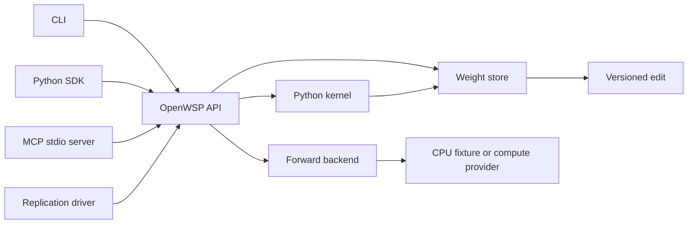

# Architecture

The CLI, Python SDK and MCP server call `OpenWSP`, one API over a weight store, a Python kernel and a forward backend. The core does not import Modal. A replication supplies the model, prompts, datasets, run policy and evaluation; it does not change the core to implement an experiment.



## Package boundaries

| Path | Responsibility |
| --- | --- |
| `src/openwsp/core.py` | Read original or edited tensors, enforce edit rules, import and export edits. |
| `src/openwsp/edits.py` | Versioned edit encoding, addresses and verification. |
| `src/openwsp/kernel.py` | Persistent Python namespace, execution limits and protocol refusals. |
| `src/openwsp/api.py` | Shared operations called by all interfaces. |
| `src/openwsp/cli.py`, `sdk.py`, `mcp_server.py` | Argument parsing or transport around the shared operations. |
| `src/openwsp/backends/` | Provider-specific forward execution. |
| `src/openwsp/editors/` | Editor API adapters and response state. |
| `replications/` | Experiment configuration, source references and results. Experiments 1–7 are layout placeholders only. |
| `tests/` | CPU tests, including a real MCP client driving a tiny network. |

## Weights and edits

The store keeps the base immutable. `load_original(name)` returns a float32 copy of the base tensor; `load(name)` returns a float32 copy of the current submitted edit when one exists. `save_edit` validates a whole tensor before replacing its submitted value. For Experiment 8, frozen final norm, embedding and output tensors, whole-tensor rescaling, wrong shapes and non-finite values are refused. The scaling check uses `rtol=1e-5` and `atol=1e-7`; these are explicit OpenWSP choices because the authors did not publish their implementation.

Submitted edits retain float32 values while the evaluated checkpoint uses bfloat16. An exported edit records the evaluated values and verifies the base and edited tensor hashes. See the [edit contract](edit-format.md). A digest identifies content, not the quality or behavioral effect of a change.

## Kernel and execution

Kernel variables survive between code runs in the same SDK kernel or MCP server process. Separate CLI invocations reload saved edits, but do not retain Python variables. The namespace exposes `NAMES`, `load`, `load_original`, `save_edit`, `drop_edit`, `edited` and `tok`. The last expression is displayed. Gradients are disabled; the replication sets code-run, time and output limits.

The Python kernel's checks enforce the research protocol. They are not an operating-system security boundary. A local SDK or MCP kernel executes with the server process's access; the Experiment 8 driver uses a separate network-blocked Modal Sandbox without secrets, with only the intended model, practice and work paths available. Model inference belongs to the forward backend.

The original Experiment 8 harness was not published. OpenWSP reconstructs its public contract from the released task messages, request/result records and scripts. Any unresolved implementation detail must be recorded in `DECISIONS.md`, not presented as a recovered original behavior.

## Use another model

Create a store from a safetensors checkpoint and pass a backend with `forward(request, store) -> dict`. Tensor reads and versioned edits are independent of the model architecture. Generation templates, tensor restrictions, hooks and grading belong in the backend and replication configuration.

```python
from openwsp.sdk import OpenWSP
from my_backend import my_forward_backend

api = OpenWSP(
    "/absolute/path/model.safetensors",
    work_dir="/absolute/path/work",
    backend=my_forward_backend,
)
print(api.list_tensors())
print(api.read_tensor("layer.weight", offset=0, limit=16))
print(api.run_code("w = load('layer.weight'); w.shape"))
print(api.diff())
api.export_edit("/absolute/path/edit", base_model="owner/model", revision="pinned-revision")
```

Changing the target model does not make an Experiment 8 result comparable to the original. Use a separate replication configuration and report it as a separate run.

## Shared operations

CLI global options, such as `--model`, `--work-dir` and `--backend`, precede the operation. For the CPU example, use `openwsp --tiny --work-dir /absolute/path/work` in their place. JSON arguments can be supplied inline or as `@/absolute/path/request.json`.

| SDK method / MCP tool | CLI operation |
| --- | --- |
| `list_tensors()` | `tensors` |
| `read_tensor(name, offset=0, limit=256)` | `read NAME --offset 0 --limit 256` |
| `run_code(code)` | `run --code CODE` or `run --file /absolute/path/cell.py` |
| `forward(request)` | `forward JSON` |
| `save_edit(name, values)` | `save NAME JSON` |
| `diff()` | `diff` |
| `apply_edit(path)` | `apply /absolute/path/edit` |
| `export_edit(path)` | `export /absolute/path/edit` |

For example, this requests paired forward results from the tiny network's base and current weights:

```sh
openwsp --tiny --work-dir /absolute/path/work forward '{"inputs": [[1.0, 0.0]], "model": "both"}'
```

## Tests and persistence

Run `uv sync --locked --extra dev`, then `uv run pytest -q`. CI uses CPU dependencies and requires no API keys or GPU. A tiny network checks that the CLI, SDK and MCP server agree on reads, code execution, forward execution and edit round trips.

Remote run state and full generation text belong on the compute volume. Git keeps source, compact edit diffs and per-sample evaluation records. State transitions, budget reservations and heartbeat recovery must refer to durable artifacts so a restart can continue from evidence rather than memory.
